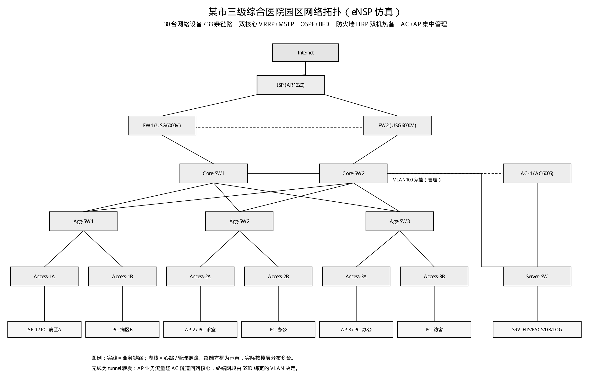

# 某市三级综合医院园区网络规划与设计（eNSP 仿真）

一套完整的医院园区网工程仿真：**30 台设备、33 条链路**，双核心 VRRP + MSTP、汇聚双上联、OSPF 与 BFD 联动、出口防火墙 HRP 双机热备与 NAT、AC + AP 无线集中管理，并按等保 2.0 三级划分安全区域。

本仓库用于归档该工程的设计文档、各设备完整配置与验证记录，便于复现与复盘。

---

## 项目状态

毕业设计仍在推进，本仓库随进度持续提交（提交历史即演进过程）。

| 模块 | 状态 | 说明 |
|---|---|---|
| 拓扑与地址规划（VLAN / IP / VRRP VIP） | ✅ 完成 | 30 台设备、33 条链路，见 `docs/01`、`docs/02` |
| 二层组网（MSTP 多实例、链路聚合） | ✅ 完成 | 核心 instance 1/2 互为主备，负载分担 |
| 三层路由（VRRP、OSPF、BFD） | ✅ 完成 | 验证命令与结果见 `docs/03` |
| 出口防火墙（HRP 双机、NAT、安全策略） | ✅ 完成 | FW1 为 master、FW2 为 standby |
| 无线（AC + AP、WPA2-PSK、访客网络） | 🚧 进行中 | 访客 ACL 隔离待实测验证 |
| 接入层安全（DHCP Snooping / 端口隔离 / 边缘端口） | ✅ 完成 | IPSG / DAI 仅在方案文档中描述，未在仿真中落地 |
| 网管与监控（Zabbix） | ⬜ 待办 | 计划新增 SRV-NMS（10.10.200.15，挂 Server-SW VLAN200） |
| 论文与答辩材料 | 🚧 进行中 | 仓库只归档工程资料，不含论文正文 |

> `✅ 完成` = 配置已完成且有验证记录；`🚧 进行中` = 配置已落地但验证闭环未走完；`⬜ 待办` = 尚未开始。

---

## 拓扑



```
                        Internet
                     /            \
              ISP(AR1220)  GE0/0/0┐   GE0/0/1
                     |            │        │
                 FW1(USG)  ──HRP── FW2(USG)
                     |       10.255.255.0/30   |
                     └──────┬─────────┘
                      Core-SW1 === Core-SW2      (VRRP 网关冗余 + MSTP 多实例)
                       /     \      /     \
                   Agg-SW1  Agg-SW2  Agg-SW3   (汇聚双上联全交叉)
                      |       |        |
                 Access-1A/B 2A/B   3A/B       (接入层 ×6)
                      |       |        |
                   AP-1/2/3 · PC · Client · STA
                      |
                    AC-1 (AC6005，旁挂管理)
```

---

## 技术要点

| 层次 | 技术 | 说明 |
|---|---|---|
| 二层 | MSTP 多实例 | 核心双机 instance 1/2 互为主备，负载分担 |
| 三层 | VRRP | VLAN10/20/30/40/50/100/200 各自一组，VIP `.254`，核心主备分担 |
| 路由 | OSPF + BFD | 核心与防火墙间动态路由，BFD 毫秒级检测链路故障 |
| 安全 | 等保 2.0 三级 | 7 个业务 VLAN，防火墙侧 trust / untrust / dmz / HRP_ZONE 四个安全区域 |
| 高可用 | FW HRP | 主备双机、会话表镜像、VRRP 虚拟网关 |
| 出口 | NAT | 源 NAT 地址池 202.101.1.2，内网 10.10.0.0/16 → Internet |
| 接入安全 | DHCP Snooping | 接入层开启，上联口设为 trusted |
| 无线 | AC + AP（tunnel 模式） | 2 个 SSID：HOSPITAL-MED → VLAN50，HOSPITAL-GUEST → VLAN40 |

---

## 地址规划

| VLAN | 名称 | 网段 | 网关(VIP) | 用途 |
|---|---|---|---|---|
| 10 | MED_ZY | 10.10.10.0/24 | 10.10.10.254 | 病区终端 |
| 20 | MED_MZ | 10.10.20.0/24 | 10.10.20.254 | 门诊终端 |
| 30 | OFFICE | 10.10.30.0/24 | 10.10.30.254 | 办公终端 |
| 40 | GUEST | 10.10.40.0/24 | 10.10.40.254 | 访客无线 |
| 50 | WLAN_MED | 10.10.50.0/24 | 10.10.50.254 | 医疗无线终端 |
| 100 | MGMT | 10.10.100.0/24 | 10.10.100.254 | 设备管理 |
| 200 | SERVER | 10.10.200.0/24 | 10.10.200.254 | 服务器区 |

服务器：SRV-HIS `10.10.200.11`、SRV-PACS `10.10.200.12`、SRV-DB/DNS `10.10.200.13`、SRV-LOG `10.10.200.14`。

设备管理地址：Core-SW1 `.1` / Core-SW2 `.2`、Agg-SW1/2/3 `.11/.12/.13`、Server-SW `.21`、AC-1 `.31`、Access-1A `.101`（1B/2A/2B/3A/3B 依次递增）。

互联段：核心 ↔ 防火墙 `10.255.1.0/29`（VRRP VIP `10.255.1.6`）；FW1 ↔ FW2 HRP 心跳 `10.255.255.0/30`；FW ↔ ISP `202.101.1.0/30`、`202.102.1.0/30`。

---

## 目录结构

```
.
├── configs/            # 16 台设备的完整启动配置（VRP 文本，可直接比对）
├── docs/
│   ├── 01-地址规划与VLAN设计.md
│   ├── 02-拓扑与设备角色.md
│   ├── 03-关键技术验证记录.md
│   └── 04-排障案例.md          ← 真实踩坑复盘，建议从这里看
├── topology/
│   └── topology.png
└── README.md
```

`configs/` 下每份文件都是从工程里直接导出的 `vrpcfg`，未做删改，可据此复现任意一台设备的配置。

---

## 如何复现

1. 安装 **eNSP 1.3.00**（含 VRP 5.170 及 AC/AP/USG6000V 镜像）；
2. 按 `docs/02-拓扑与设备角色.md` 中的连线表还原拓扑；
3. 将 `configs/<设备名>.cfg` 的内容整体粘贴进对应设备（先 `system-view` → 粘贴 → `save`）；
4. 依次验证 `docs/03-关键技术验证记录.md` 中的命令与预期输出。

> 说明：本工程为教学仿真，配置里的口令、证书与地址均为实验值，不对应任何真实网络。

---

## 仿真环境的已知边界

在 eNSP 里做这套工程时踩到的平台限制，一并记录，避免复现时误判为配置错误：

- **Server 设备没有 RADIUS 与 DHCP 服务** → 无线只能做 WPA2-PSK，802.1X 需真机或外接认证服务器；
- **VRRP 虚拟 IP 不响应 ICMP** → `ping` 网关超时属于平台现象，业务流量正常；
- **FTP 服务只提供小于 1MB 的文件**，大文件需切分；
- **Client 设备的“C 盘”就是宿主机磁盘**，下载文件会落到真实硬盘；
- **设备内 `save` 只写虚拟 flash**，工程要另外 Ctrl+S 才会落盘到宿主机。